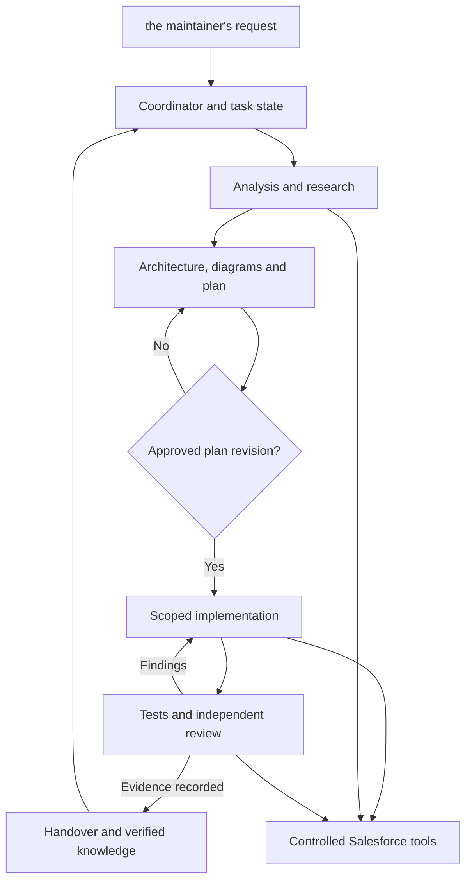

# Salesforce Work Assistant — enhancement architecture

Feature: SF-ASSISTANT-001
Revision: 1
Status: proposed — implementation approval pending
Date: 2026-10-17
Baseline: initial clean public distribution
Owner/approver: the repository maintainer
Target: Claude Code in VS Code, Windows first; Salesforce sandbox integration after local verification.

## Outcome

Build a coordinated Salesforce engineering assistant for substantial development and
enhancement work: analyze, research, architect, plan with diagrams, implement, test,
review and preserve verified knowledge. Small acceptance fixtures verify behavior;
they do not limit the size of supported projects. Large tasks are decomposed into
approved increments rather than loading an entire org into one context window.

This document is a proposal, not a statement that the capabilities are implemented.
The user's request to enhance the repository authorizes this planning work. Approval
of this concrete revision will authorize implementation and publication of the
repository enhancement, not installation on the user's computer or org mutations.

## Current-system evidence and reuse

At the baseline:
- skills/ contains 20 self-contained custom workflows; vendor/sf-skills is pinned.
- sf-route-work, sf-design-architecture, sf-build-apex, sf-test-behavior,
  sf-investigate-issue and sf-release-change cover much of the requested process.
- Each skill bundles runtime and project-lifecycle instructions. Architecture
  approval, deviation review and source freshness are currently behavioral rules.
- scripts/install_skills.py performs dry-run or copy and rejects existing targets.
- scripts/metadata_snapshot.py hashes local source and extracts selected metadata;
  scripts/compare_snapshots.py compares snapshots. Neither establishes live org state.
- scripts/doctor.py reports tools, not authentication or product entitlement.
- Project templates exist; there is no automatic checkpoint/research/approval runtime.
- CI is Ubuntu/Python 3.12; Windows and live Claude/sandbox validation are outstanding.

Reuse these skills and utilities. Extend their interfaces compatibly. Keep the pinned
upstream unchanged. Use ECC as a design reference for selective patterns, not a bulk
dependency or competing workflow authority. If source is later copied, review its
dependencies and retain required license attribution.

## Architecture

Material design deviations return to plan review; ordinary defect correction within
the approved design can continue. Passing checks never automatically authorizes release.

### Roles and handoffs

| Role | Existing foundation / proposed extension | Required output |
| --- | --- | --- |
| Coordinator | Extend sf-route-work | Task ID, scope, state, selected skills and next authorized step |
| Analyst | Investigation, audit and snapshot tools | Current-system evidence, missing scope and reuse candidates |
| Architect/solution designer | sf-design-architecture plus domain skills | Alternatives, selected design, dependencies, security and recovery |
| Planner | Architecture workflow | Numbered requirements, phases, acceptance tests and relevant diagrams |
| Developer | Apex and relevant Flow/LWC/integration workflows | Minimal changes traced to requirements; no invented API names |
| Tester | sf-test-behavior | Test cases and actual results, including unavailable checks |
| Reviewer | New focused review skill/Claude role adapter | Findings against diff, plan and evidence, independent of developer conclusions |
| Researcher | New research workflow | Official sources, retrieval dates, product/version applicability and uncertainty |
| Knowledge maintainer | Extend lifecycle/checkpoint tools | Scoped handover, verified facts and proposed lessons |

Use one coordinator. Delegate specialist review when supported and useful, not
unconditionally. Planner and reviewer adapters receive read-only tools by default.
Only the coordinator updates task state and approved knowledge; workers return
findings, preventing concurrent writers from overwriting records. If separate agents
are unavailable, label the sequential review accurately rather than claiming independence.

Research uses available authorized browser/search/MCP tools. Missing network or tools
must produce an explicit gap, not fabricated citations. Research does not retrain a model.

## Project data boundaries

Reusable workflows, templates, schemas, tests and installer belong in this hub.
Company code, plans, architecture and lessons belong in its approved company project.
Credentials remain in supported credential stores, never in records or skill files.
Sensitive logs and record exports stay outside version control; retain only approved
sanitized evidence summaries. Do not copy project-specific context into unrelated projects by default.

Proposed project records:
- docs/assistant/INDEX.md and existing Markdown architecture/handover records.
- docs/assistant/features/<id>/plan.md plus plan.json for machine-checkable mappings.
- docs/assistant/decisions/ for accepted architecture decisions.
- docs/assistant/research/ for reviewed, sanitized source notes.
- Ignored .sf-assistant/ for local task state, evidence manifests and checkpoints.

Use versioned JSON schemas alongside readable Markdown, standard-library Python
utilities, atomic writes and per-project state. Preserve old records during migrations.
State stores source hashes, plan revision, observation time and environment provenance.
Distinguish locally observed metadata from authenticated org retrieval. User-entered
org labels are not verified identities. Hash changes indicate possible staleness, not
semantic defects or proof of live-org freshness.

Approvals record the actual approving interaction and approved plan revision/digest.
An editable JSON status is an audit record, not an authentication or security boundary.

## Requirements and acceptance

| ID | Requirement | Proposed components | Acceptance |
| --- | --- | --- | --- |
| R1 | Coordinate roles and scoped increments | Router, role adapters, task schema | New request selects relevant workflow; unresolved failures begin with investigation |
| R2 | Plan before implementation, track deviations | Plan schema, lifecycle, plan checker | Missing approval blocks implementation workflow; changed plan requires scoped reapproval |
| R3 | Produce useful diagrams | Architecture skill and templates | Relevant architecture/sequence/data diagram agrees with plan; unknown relationships marked |
| R4 | Inspect and reuse current systems | Analyst, snapshot and evidence tools | Stale notes flagged; reuse/extend/new decisions cite inspected evidence and gaps |
| R5 | Develop against requirements | Developer workflows and traceability report | Changed components map to requirements; unexplained changes are flagged |
| R6 | Test and independently review | Tester, reviewer adapter, evaluation fixtures | Seeded defects found; results distinguish local, sandbox and unrun checks |
| R7 | Research and maintain lessons | Research skill and lesson schema | Official sources and version scope recorded; unreviewed lessons never override decisions |
| R8 | Resume with durable context | Checkpoint/resume utility, optional host adapter | Fresh session finds active plan, local edits and pending checks; interrupted writes preserve prior checkpoint |
| R9 | Install, upgrade and recover safely | Extend installer with ownership manifest | Dry-run makes no changes; local edits preserved; partial failures recover; rollback only touches managed files |
| R10 | Control sandbox reads | Typed Salesforce runner and fixtures | Explicit identity mismatch, production target, unsupported operation or malformed input fails before task execution |
| R11 | Prevent instruction-copy drift | Canonical lifecycle plus generator/check | Generated per-skill copies match canonical source and stay independently installable |
| R12 | Validate on Windows and Linux | CI matrix and behavioral evaluations | Paths with spaces, upgrades and subprocess handling pass; actual Claude/org checks stay separately reported |

Plan checking is structural plus reviewer judgment: it cannot prove semantic compliance
from filenames, hashes or requirement IDs alone. Do not equate all-green structure
checks with architecture correctness.

## Salesforce tool design and access limits

First release implements a narrow sandbox read runner, not arbitrary shell commands:
1. Accept a typed request with explicit target, expected org identity, operation and
   bounded inputs. Never concatenate input into shell command strings.
2. Verify authenticated org identity and sandbox status with supported CLI/API
   operations before any business query. Redact authentication material from output.
3. Allow only reviewed operations initially: identity check, bounded record query,
   and metadata describe/list. Reject anonymous Apex, deployment, data mutation,
   production targets and unknown flags. The final command mappings must be checked
   against current Salesforce CLI help during implementation.
4. Return a bounded result with timestamp, source version where available, target
   identity, scope/truncation status and sanitized error metadata.
5. Retrieval into the working project remains manually reviewed initially because it
   writes local files. Design a separate staging-and-diff retrieval path before enabling it.
6. Sandbox deployment and test execution continue through separately authorized,
   host-approved commands. Automated write execution is a later design revision.

A wrapper cannot constrain an agent that also has unrestricted shell or direct CLI
access. Installation must not auto-allow Bash, PowerShell or arbitrary sf commands.
Host approvals and least-privilege credentials remain necessary. Hooks improve workflow
compliance but are not an org permission boundary. Do not modify host policy automatically.

## Research and learning policy

Recall relevant verified records, identify a concrete gap, research official sources,
check applicability to package/API versions, and record a proposed lesson with evidence.
A successful one-time workaround is not automatically a recommended standard.
Human review promotes a lesson into project guidance. Preserve superseded history.
Do not silently promote company facts to global memory or import all ECC learning rules.
Research occurs during requested work; unattended monitoring/scheduling is out of scope.

## Implementation milestones

1. Foundation: canonical lifecycle generation; JSON schemas; router and role contracts;
   update stale validation summaries. Keep existing skills and installation working.
2. Design/research/review: add focused missing skills and optional Claude role adapters;
   diagram conventions; plan traceability; synthetic end-to-end evaluations.
3. Knowledge: extend snapshot provenance; freshness diagnostics; atomic checkpoints,
   resume and reviewed-lesson flow. Explicit checkpoint command remains fallback.
4. Installation: dry-run project setup, managed-file version manifest, backup/conflict
   detection, upgrade recovery, rollback and optional hook registration preview.
   Never overwrite existing CLAUDE.md or settings without an explicit reviewed merge.
5. Sandbox access: implement read runner with mocked CLI tests; add setup guidance for
   verifying credentials and target identity. No live org action in repository CI.
6. Release: Windows/Linux CI, integration fixtures, documented migration and final
   acceptance checklist. Publish a tested repository release for users to install.

Implement on an enhancement branch and publish a reviewable pull request. Do not
merge that implementation automatically. Architecture approval authorizes this
repository implementation and PR publication, not org deployment or external messages.

## Test strategy

Retain the existing suite. Add tests for:
- missing/changed plan approval, fabricated completion and unexpected changed files;
- stale/conflicting notes, incomplete retrieval, dirty working tree and source deletion;
- corrupted state, interrupted writes, duplicate checkpoints and wrong-project resume;
- first install, dry-run, user-edited managed files, upgrade conflicts and rollback;
- path traversal, symlinks, spaces, Unicode paths and Windows subprocess behavior;
- wrong org, production org, expired authentication, unsupported commands, injected
  flags, oversized results, redaction and timeout;
- online source unavailable, version-mismatched advice and rejected lesson promotion.

Independent synthetic scenarios cover architecture planning, approved implementation,
material deviation, seeded review defects and resumed work. Preserve outputs and
criteria without leaking expected answers to the acting agent. Record host/model
and versions where available.

Then run manual Claude Code acceptance on the maintainer's Windows machine, followed by an
explicitly authorized sandbox read. A local fixture or green CI does not certify
Salesforce runtime behavior. No destructive tests or credentials in CI.

## Alternatives and risks

- Full ECC installation: offers broad infrastructure but adds competing workflows,
  dependencies and configuration complexity; not selected for this release.
- Instructions only: simplest, but insufficient for upgrades, checkpoints and evidence
  integrity; retain instructions alongside small testable utilities.
- New hosted app/vector database: unnecessary operations and data movement now;
  use scoped local records and search first.
- Model variability: mitigated through evaluation and evidence review, never a guarantee.
- Context growth: load task-relevant records; summarize with provenance, not all skills.
- Hooks differ by host version: verify current documentation during implementation;
  provide explicit commands when a hook is unsupported.
- Semantic dependency discovery remains incomplete, especially managed packages.
  Report retrieval coverage and unsupported boundaries rather than claim a complete org map.

## Rollback and release boundaries

Tag or record the previous hub commit and installed file manifest. Back up only files
being changed. Roll back managed files after checking for user edits; retain company
plans and knowledge. Disable newly registered optional hooks without removing existing
host configuration. Never reset the company's Git working tree.

Implementation starts after approval of revision 1. Material changes to these choices
require a revised plan. Live setup, credentials, target alias and host versions can be
confirmed at installation time and do not block offline repository implementation.

## Approval history

2026-10-17: Revision 1 prepared following the maintainer's request to enhance the repository.
Status: awaiting explicit approval of this architecture revision.

